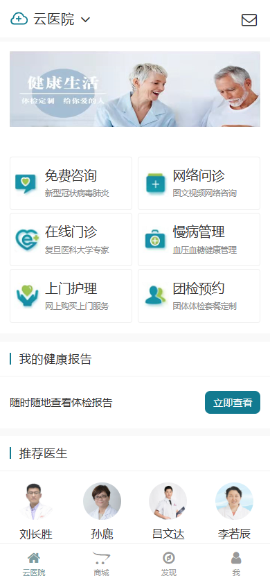
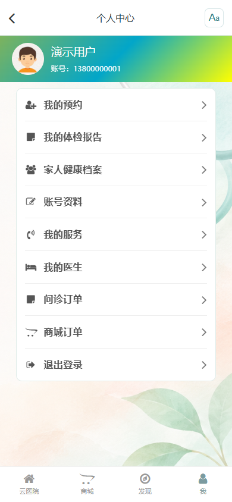
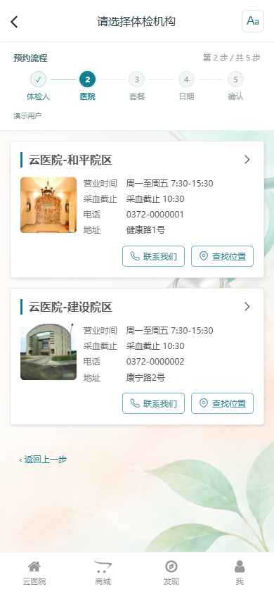
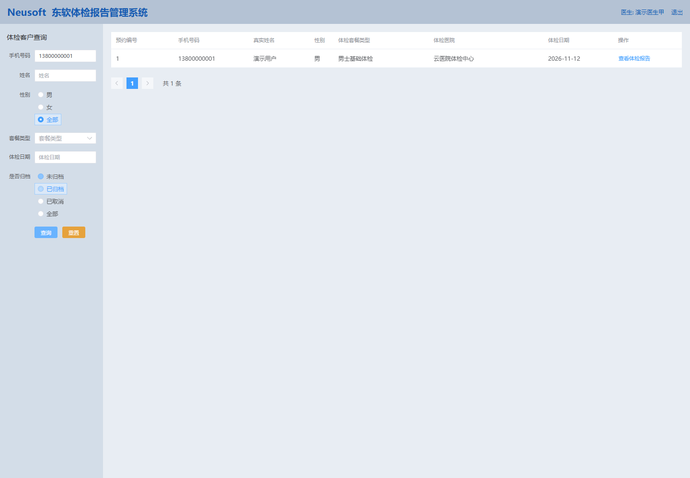
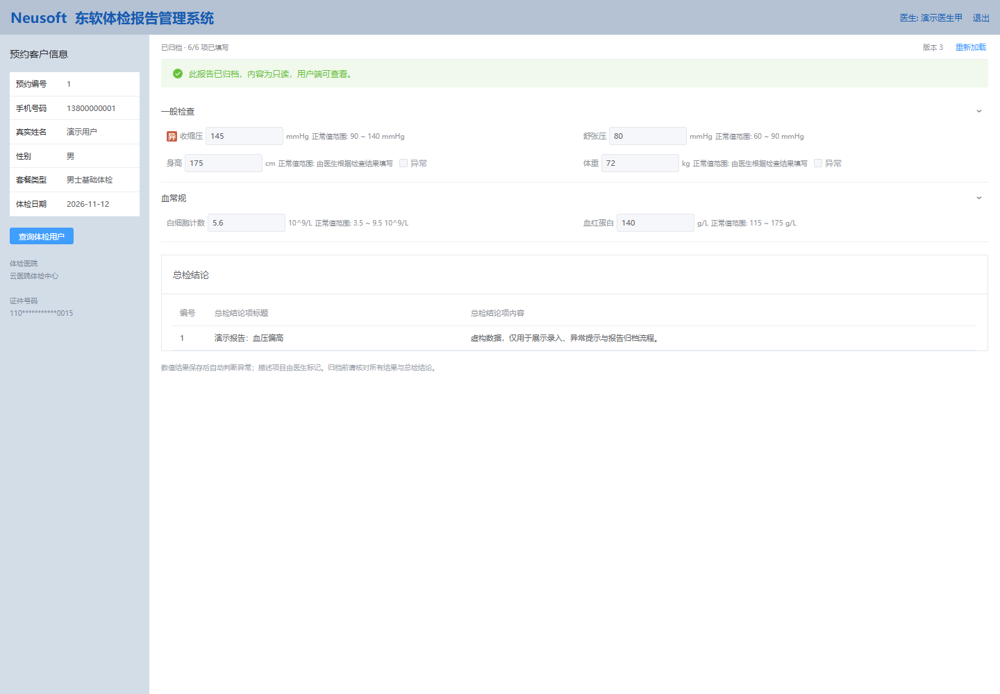

# 体检预约与报告管理系统

基于《东软体检项目系统-实践手册(6)》完善的课程项目，重点展示前端页面还原、Vue 组件与路由、表单交互及前后端联调，后端提供预约、报告和数据库持久化支持。

所有代码统一维护在 **main 分支**。采用一个仓库、多个模块的结构；`main.js` 和 Java 的 `main()` 只是启动入口，业务代码按职责分别放置。原目录的 13 个 HTML 页面及 css/js/img 保留作学习参考，实际运行入口为下列三个独立工程。

前端以手册原型为准：保留移动端 APP 布局、原图片和栏目顺序；医生端按蓝灰顶栏、左查询/信息区、右表格/报告区实现。新增功能沿用原样式，并保留已确认的云医院品牌、首页滚动和个人菜单调整。

**使用与开发入口：** [用户、医生与管理员操作说明](docs/USER_GUIDE.md) · [逐页对照与修改指南](docs/FRONTEND_GUIDE.md) · [前端验收清单](docs/FRONTEND_CHECKLIST.md) · [用户端源码导读](user-web/README.md) · [医生端源码导读](manage-web/README.md)

| 工程       | 技术                                            | 默认端口 |
| ---------- | ----------------------------------------------- | -------- |
| user-web   | Vue 3、Vue Router、Axios、Vite，普通 JavaScript | 8081     |
| manage-web | Vue 3、Element Plus、Axios、Vite                | 8089     |
| server     | Java 17、Spring Boot 3.5、MyBatis、MySQL 8      | 8080     |

## 页面预览

以下为本项目运行截图，使用虚构课程数据。

| 用户首页                                                         | 个人中心                                                             | 体检机构                                                              |
| ---------------------------------------------------------------- | -------------------------------------------------------------------- | --------------------------------------------------------------------- |
|  |  |  |

| 医生预约查询                                                                       | 医生报告录入                                                                       |
| ---------------------------------------------------------------------------------- | ---------------------------------------------------------------------------------- |
|  |  |

## 仓库目录

| 目录／文件                                                | 内容与修改入口                                                          |
| --------------------------------------------------------- | ----------------------------------------------------------------------- |
| [user-web/](user-web/)                                    | 用户前端；`src/views` 页面，`components` 公共组件，`style.css` 公共样式 |
| [manage-web/](manage-web/)                                | 医生与管理前端；查询、检查录入、归档和基础资料维护                      |
| [server/](server/)                                        | 共享后端；Controller、Service、MyBatis Mapper 和测试                    |
| [database/](database/)                                    | 建表、文案迁移和独立重置脚本                                            |
| [docs/](docs/)                                            | 页面与手册对照、工程分层、数据库、测试和答辩说明                        |
| [scripts/](scripts/)                                      | Windows 启动、停止、构建及独立数据库脚本                                |
| [tests/](tests/)                                          | HTTP、并发及浏览器流程检查                                              |
| 根目录 13 个 `.html`、`css/`、`js/`、`img/`、`framework/` | 早期静态页面与资源，供对照学习；直接打开 HTML 不会进入 Vue 完整业务流程 |
| [.github/workflows/ci.yml](.github/workflows/ci.yml)      | main 提交后自动构建两端、后端并运行独立 MySQL 测试                      |

前端主流程：**登录 → 本人／家属 → 医院 → 套餐 → 日期 → 确认订单 → 医生录入归档 → 用户查看报告**。完整工程关系见 [ARCHITECTURE.md](docs/ARCHITECTURE.md)。

## 快速运行（Windows）

本机需要 Java 17、Node.js 22.12 以上、Maven 3.6.3 以上、MySQL 8 和 PowerShell 7。本项目运行脚本也能识别当前电脑的 IDEA 内置 Maven。其他电脑可设置 `MAVEN_HOME`、`MYSQL_HOME` 或将相关命令加入 PATH。

获取源码后，在项目根目录双击 `start.cmd`，或在 PowerShell 7 中运行：

```powershell
pwsh -NoProfile -File .\scripts\start.ps1
```

首次运行会安装前端依赖、构建两端和后端；网络环境应能访问 npm 与 Maven Central。后续可以通过 `-SkipBuild` 复用现有构建。

启动脚本在 `.runtime/mysql` 建立独立 MySQL 数据目录，监听 `127.0.0.1:3307`，自动创建 `tijian` 和 `tijian_test`。不修改已安装的 MySQL Windows 服务。随机数据库凭据保存在已忽略提交的 `.runtime/local-db.json`，无需猜测或修改原 MySQL 的 root 密码。

8080 被占用时，脚本自动改用 18080，并同步配置两个前端代理。不会终止占用进程。成功后访问：

- 用户端：<http://127.0.0.1:8081/>
- 医生/管理员端：<http://127.0.0.1:8089/>

请使用同一个主机名 `127.0.0.1`，避免混用 localhost 导致浏览器会话不一致。两端支持同一浏览器同时登录且独立退出。

## 演示账号

| 身份       | 账号        | 密码       | 权限                                 |
| ---------- | ----------- | ---------- | ------------------------------------ |
| 用户       | 13800000001 | Health123! | 自己及家属的预约和报告               |
| 医院一医生 | D001        | Doctor123! | 所属医院的报告                       |
| 医院二医生 | D002        | Doctor123! | 所属医院的报告                       |
| 管理员     | admin       | Admin123!  | 医院、套餐、检查项、医生、排班等管理 |

上述账号及身份数据均为虚构演示数据。支付仅用于课程练习，确认页注明不产生真实扣款，未接真实支付或短信服务。种子初始化只补充缺失数据，不重置用户修改过的密码与配置。

## 使用自己的数据库

先创建专用数据库并为专用账号授权，再在当前终端设置环境变量：

```powershell
$env:DB_URL = 'jdbc:mysql://127.0.0.1:3306/tijian?useUnicode=true&characterEncoding=UTF-8&serverTimezone=Asia/Shanghai'
$env:DB_USERNAME = 'health_app'
$env:DB_PASSWORD = '你自己配置的密码'
.\scripts\start.ps1
```

`.env.example` 仅用于说明变量，脚本不会自动读取它。后端启动执行 `CREATE TABLE IF NOT EXISTS` 建表，种子数据可通过 `SEED_ENABLED=false` 关闭。不要将项目指向包含同名旧表的未知数据库；本次提供的是新结构初始化，不包含旧后端数据库的自动迁移。

## 停止与单独开发

```powershell
.\scripts\stop.ps1                 # 只停止本项目记录的 Web 进程
.\scripts\stop-local-mysql.ps1     # 正常停止独立 MySQL，保留数据
.\scripts\build.ps1                # 重新构建三个工程
```

重新构建前请先停止项目 Web 服务，避免 Windows 锁定运行中的 JAR 或前端依赖。独立数据库可以继续运行。

也可分别启动：在 server 中运行 Maven `spring-boot:run`（需先设置数据库环境变量）；在两个前端分别运行 `npm install` 和 `npm run dev`。后端改端口时，前端启动环境同步设置 `VITE_API_TARGET=http://127.0.0.1:端口`。

## 验证与说明

- `npm install` 后，`npm run test:api` 执行真实 HTTP 接口验收；默认后端为 18080，可用 `API_BASE` 改写。接口验收会创建带“自动化测试”前缀的虚构数据。
- `npm run test:e2e` 执行浏览器流程验收，使用本机 Edge，无需下载另一套浏览器。
- 后端 MySQL 集成测试使用独立 `tijian_test` 库，详见 `docs/TESTING.md`，不要指向业务库。
- 构建输出：两个前端各自的 `dist`，后端 `server/target/*.jar`。启动脚本运行 Vite 本地服务；对外部署需要另行配置静态托管、反向代理与 HTTPS。
- 接口字段与请求示例见 `API_CONTRACT.md`；数据库关系与手册对应见 `docs/DATABASE.md`；答辩步骤见 `docs/DEMO.md`。

## 提交与协作

源码、锁定依赖版本的文件、数据库脚本、中文文档和 `docs/images/` 精选截图一同维护在 main。`node_modules/`、`dist/`、`target/`、`.runtime/`、本机连接密码和自动化运行输出由 `.gitignore` 排除；构建产物可以本地重新生成，也可在 GitHub Actions 构建完成后下载。

继续修改时先阅读 [前端导读](docs/FRONTEND_GUIDE.md)，完成对应页面检查，再提交具体文件：

```powershell
git pull --ff-only origin main
git status
git add user-web/src/views/Home.vue
git commit -m "调整首页健康评估交互"
git push origin main
```

自动构建配置见 [.github/workflows/ci.yml](.github/workflows/ci.yml)。MySQL 测试在独立临时库执行；实际浏览器业务流程仍按 [测试说明](docs/TESTING.md) 在本地启动服务后检查。

日志保存在 `.runtime`。如启动失败，优先查看 `server.stdout.log`、`server.stderr.log` 及对应前端日志。
