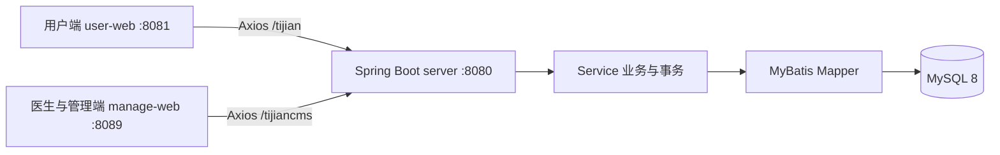

# 工程框架与代码导读

本仓库在 `main` 分支统一维护两个前端和一个共享后端。这里的 main 指 Git 分支；Vue 的 `main.js` 只负责创建应用，Java 的 `main()` 只负责启动 Spring Boot，业务代码按模块和职责分别组织。

## 整体关系

开发时由 Vite 代理接口，因此前端统一写相对接口路径。后端两个接口前缀共享服务和数据库；用户、医生分别登录并独立退出。脚本遇到 8080 占用会选择 18080，设置 `VITE_API_TARGET` 与后端保持一致。

## 先读前端

1. `user-web/src/main.js` → `App.vue`：应用入口、公共顶栏、底栏与消息提示。
2. `user-web/src/router.js`：页面路由、预约步骤和登录守卫。
3. `user-web/src/views/Home.vue` → `Booking.vue`：首页与预约主流程。
4. `user-web/src/api.js` → `state.js`：Axios、后端会话、预约草稿和格式化函数。
5. `manage-web/src/views/Orders.vue` → `Report.vue`：查询分页、检查结果录入、总检结论和归档。
6. 两端的 `src/style.css` 与各页面 `<style scoped>`：公共样式与页面局部样式。

详细页面、路由、文件及手册页码见 [前端导读](FRONTEND_GUIDE.md)。修改界面时优先保留手册结构，再调整具体组件；新增家属、资料等功能沿用同一套颜色、行式表单和按钮。

## 后端各层

源码根目录：`server/src/main/java/com/neusoft/health/`。

| 位置                                     | 职责                                           |
| ---------------------------------------- | ---------------------------------------------- |
| `HealthApplication.java`                 | Spring Boot 启动入口                           |
| `controller/HealthController.java`       | 接收两端 HTTP 请求，取得会话身份，调用业务服务 |
| `service/AccountService.java`            | 注册、登录、密码与体检人档案                   |
| `service/CatalogService.java`            | 医院、套餐、检查项目和可预约日期               |
| `service/OrderService.java`              | 预约、名额、取消、报告保存及归档的事务         |
| `service/AdminService.java`              | 医院、套餐、检查项、医生与排班维护             |
| `mapper/Database.java`、`SqlMapper.java` | MyBatis 参数化 SQL 访问                        |
| `entity/Principal.java`                  | 当前用户或医生身份                             |
| `dto/`、`config/`                        | 统一响应、业务异常、Web 配置和虚构初始数据     |

当前课程实现使用普通 JavaScript 和较少的公共工具；后端部分请求使用 Map 承载字段，未为每个接口单独创建 DTO 类。入口和业务处理已分层，不将所有业务写入 main 方法。

## 数据与关键规则

- 医院 → 医院套餐关联 → 套餐 → 检查项及明细，决定可预约内容。
- 账号 → 本人／家属档案 → 订单，后端校验归属；医生按所属医院查询。
- 订单保存姓名、医院、套餐、价格及报告项目快照，资料后续变化不会改写历史。
- 预约事务同时处理名额、订单、报告模板和练习支付；重复提交的 requestId 返回原订单。
- 报告使用版本号检查并发保存。必填结果及总检结论完整后可归档，归档后用户可查看、医生只读。

数据库关系见 [DATABASE.md](DATABASE.md)，请求字段见 [API_CONTRACT.md](../API_CONTRACT.md)。

## 与手册示例的工程差别

手册(6)展示 Vue CLI、Java 8 / Spring Boot 2 的示例工程。本项目沿用已确认的 Vue 3 + Vite、Java 17 + Spring Boot 3.5，以及共享后端结构，保留主要页面、业务步骤和接口名称。课程展示重点是页面还原、Vue 数据绑定与路由、Axios 联调，以及完整预约和报告流程。
