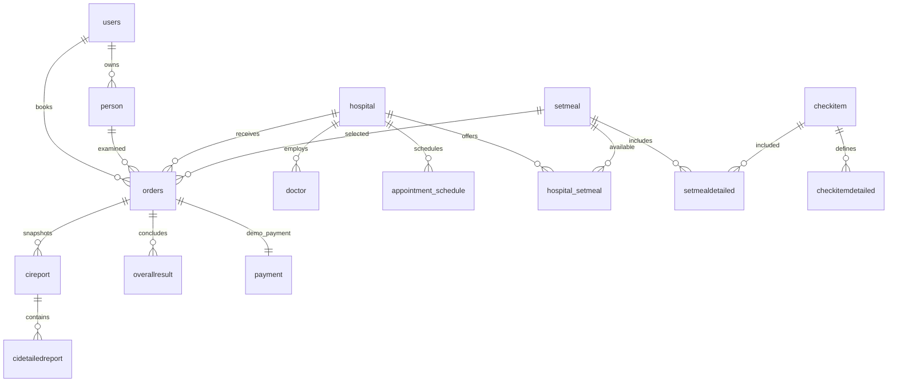

# 数据库设计与手册对应

数据库使用 MySQL 8 / InnoDB / utf8mb4，共 15 张业务表及 1 张初始化版本记录表 seed_history。金额使用 DECIMAL，日期使用 DATE，密码仅存 BCrypt 哈希。Java 通过 MyBatis 参数绑定访问数据库，事务由 Spring 管理。

## 数据关系

## 表与关键字段

| 表                   | 关键字段及作用                                                   |
| -------------------- | ---------------------------------------------------------------- |
| hospital             | hpId、机构名称/地址/电话/营业时间、state；停用保留引用           |
| users                | 手机号 userId 主键、密码哈希、姓名、性别、生日、证件             |
| doctor               | docCode 唯一工号、密码哈希、hpId 所属医院、role、state           |
| person               | userId 归属、isSelf 本人标记、家属关系、规范化证件散列、state    |
| setmeal              | 套餐名称、type（0女/1男/2不限）、price、state                    |
| setmealdetailed      | 套餐与检查项目多对多关联，组合唯一                               |
| checkitem            | 检查项目名称、内容、意义、说明与状态                             |
| checkitemdetailed    | 检查明细名称、单位、参考范围/正常值、类型、必填标记              |
| hospital_setmeal     | 医院与套餐的关联，组合主键                                       |
| appointment_schedule | 医院与日期组合主键、capacity、used；容量不得低于已占用           |
| orders               | 账号、体检人、医院、套餐、日期、状态、请求幂等键、快照、报告版本 |
| cireport             | 订单对应的检查项快照；orderId/ciId 唯一                          |
| cidetailedreport     | cirId 父报告、明细定义快照、value、isError；订单/源明细唯一      |
| overallresult        | orderId、title、content，保存医生总检结论                        |
| payment              | 订单唯一、金额、DEMO 渠道、PAID/REFUNDED 状态                    |

## 关键约束与事务

- 档案在账号内按证件散列唯一。完整身份证不返回浏览器，编辑留空表示保留，订单仅保存脱敏证件快照。
- 订单 `activeIdentity` 是生成列：未归档时为证件散列，其余状态为 NULL；唯一索引阻止不同账号给同一体检人重复有效预约。该散列不作为授权凭据，也不返回前端。
- `(userId,requestId)` 唯一保证下单幂等。订单、名额、报告快照与演示支付在同一事务中提交或回滚。
- 取消保留订单，将演示支付置为 REFUNDED 并只释放一次名额；已归档订单仍保留预约日的历史占用。
- 报告录入、结论修改、取消与归档协调锁定订单。每次报告写入递增 `reportVersion`，旧版本提交返回 409。
- 订单状态：1未归档、2已归档、3已取消。`reportStarted` 表示已保存报告内容。已归档和已取消报告不能继续编辑。
- 归档前检查所有必填项和至少一条结论；仅已归档报告对预约账号开放。

## 相对手册的调整

保留 hospital、users、doctor、setmeal、setmealdetailed、checkitem、checkitemdetailed、orders、cireport、cidetailedreport、overallresult 这 11 个核心实体与主要接口命名。

1. 原 userId 仍为手机号；独立 person 表补充本人/家属档案，订单同时记录预约账号与实际体检人。
2. 原 orders 仅含两个状态，本项目增加取消状态、幂等键、历史快照和报告版本。
3. 原 hospital.rule 字符串未定义规则格式，本项目使用明确的按日期名额表；原字段保留作对应说明。
4. 原套餐全局共享，本项目增加医院套餐关联，避免任意医院接受未开设套餐。
5. 原 cidetailedreport.ciId 的说明含糊，本项目以 cirId 明确指向 cireport.cirId。
6. 密码字段扩容保存哈希；套餐价格调整为十进制定点金额；数值参考范围亦使用 DECIMAL。
7. 手册分别建立用户/医生两个后端，本项目合并业务服务，保留 `/tijian` 和 `/tijiancms` 两组接口以便对照。

建表脚本以 `server/src/main/resources/db/schema.sql` 为准。初始化不清库、不覆盖配置；重置脚本必须由使用者明确选择执行。
